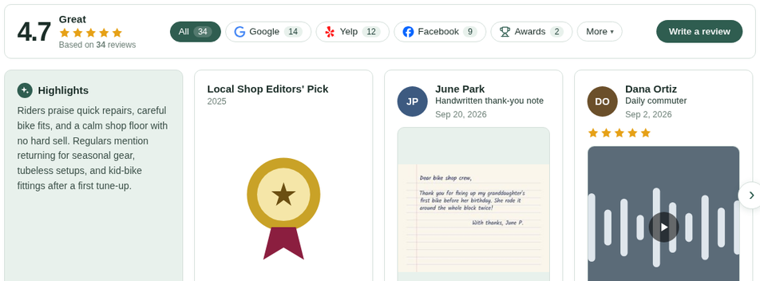

# CRED

An open-source widget for reviews, testimonials, awards and credentials. Unlimited sources, no tracking, and your data stays in your own repository.

## See it in action

[**Live demo**](https://cred.bristleconeweb.com/) · [Light](https://cred.bristleconeweb.com/?theme=light) · [Dark](https://cred.bristleconeweb.com/?theme=dark)

<picture>
  <source media="(prefers-color-scheme: dark)" srcset="docs/example-widget-dark-v7.png" />
  <source media="(prefers-color-scheme: light)" srcset="docs/example-widget-light-v6.png" />
  
</picture>

The starter includes the same working widget, example reviews, photos and theme as the demo, ready to make your own.

## Make your own

<a href="https://github.com/bristweb/cred-starter/generate"></a>

1. **Create your repository** with the button above. Choose a name and public or private visibility.
2. **Make your changes in GitHub.** Edit `data/config.js` for your business, replace the example reviews in `data/reviews/`, and add your images and colors in `data/assets/` and `data/theme/`. No local installation needed.
3. **Publish and embed.** Follow [your starter's publishing guide](https://github.com/bristweb/cred-starter#publish-it) and give it its own subdomain, such as `reviews.EXAMPLE.COM` (or `store1.reviews.EXAMPLE.COM` for each of several stores). Then paste this into your website:

```html
<script src="https://reviews.EXAMPLE.COM/package/assets/js/cred.js" defer></script>
```

The `*.pages.dev` and `*.github.io` addresses are fine for demos and testing. Real sites should use their own subdomain.

## Get Cred updates

In your repository, run **Actions → Update Cred package** with a [release tag](https://github.com/bristweb/cred/releases). Review and merge the pull request. It updates only `package/`, leaving your reviews, pages and README alone.

## Documentation

- [Publishing](https://github.com/bristweb/cred-starter#publish-it) — GitHub Pages or Cloudflare Pages, including private repositories and [your own subdomain](https://github.com/bristweb/cred-starter#use-your-own-subdomain).
- [Data format](docs/REFERENCE.md#data-format) — business details, reviews, images and themes.
- [Embed and options](docs/REFERENCE.md#embed) — website builders, iframes, layouts and light or dark mode.
- [Full reference](docs/REFERENCE.md) — validation, updates, structured data and advanced settings.
- [Product comparison](docs/COMPARISON.md) · [Changelog](CHANGELOG.md)

## License

[MIT](LICENSE). Free to use, host and customize.
